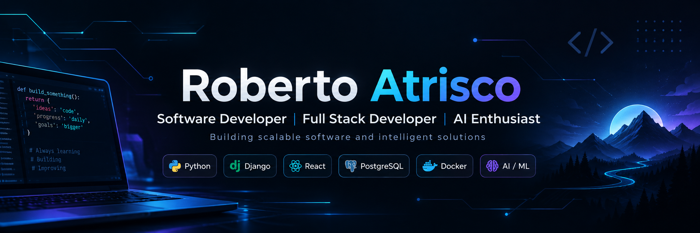

  

 

# Hi there! I'm Roberto Atrisco 👋

### 💻 Software Developer | Full Stack Developer | AI Enthusiast

🎓 Software Development and Management Engineering Student

🚀 Passionate about building innovative, scalable, and efficient software solutions.

🧠 Exploring Artificial Intelligence, Software Architecture, and Modern Web Technologies.

---

## 👨‍💻 About Me

I'm a Software Development and Management Engineering student passionate about technology, programming, and building real-world software solutions.

I enjoy developing full-stack applications, designing efficient software architectures, and exploring how Artificial Intelligence can improve modern systems.

- 🎓 Currently studying Software Development and Management Engineering.
- 💻 Focused on Full Stack Web Development.
- 🤖 Interested in Artificial Intelligence, Machine Learning, and AI-powered applications.
- 🏗️ Passionate about Software Architecture and scalable systems.
- 📱 Experienced with web and mobile development technologies.
- 🌱 Continuously learning new technologies and development practices.
- 🤝 Open to collaborating on innovative software projects.

---

## 🛠️ Tech Stack

### 👨‍💻 Programming Languages

### 🌐 Frontend Development

### ⚙️ Backend Development

### 🗄️ Databases

### 🚀 Tools & Technologies

---

## 🚀 Featured Projects

### 🏥 Health Market

A web application developed with Django, focused on building modern digital solutions for healthcare-related services.

🔗 [View Repository](https://github.com/Roberto2023-code/New-Health-Market)

### 📊 Interactive Dashboard with Fetch API

A dynamic JavaScript dashboard that consumes REST API data, implements asynchronous requests, and uses DOM manipulation to display interactive information.

🔗 [View Repository](https://github.com/Roberto2023-code/Practica-3.2-Dashboard-de-Datos-con-Fetch-API)

### 🎮 3D Training Environment

A Unity-based 3D game development project focused on creating interactive environments and implementing gameplay mechanics.

🔗 [View Repository](https://github.com/Roberto2023-code/Campo2Entrenamiento3D)

---

## 🎯 Professional Interests

- Full Stack Software Development
- Software Architecture and System Design
- Artificial Intelligence and Machine Learning
- REST API Development and Integration
- Cloud Technologies and DevOps
- Software Engineering Best Practices

---

## 📊 GitHub Analytics

  

  

---

### 🤝 Let's Connect!

I'm always interested in learning, collaborating, and exploring new opportunities in software development.

---

⭐ **Thanks for visiting my GitHub profile!**

